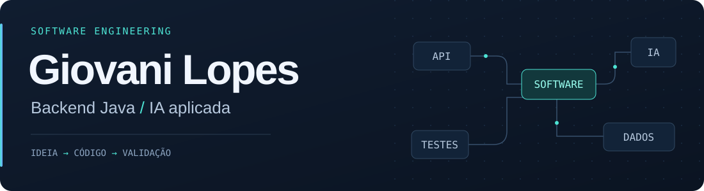

  

  
  &nbsp;
  

## Software que conecta sistemas e resolve problemas

Sou **Software Engineer Trainee L3 na LEVTY** e estudante de **Sistemas de Informação na UFU**. Trabalho com desenvolvimento web, integração de sistemas corporativos e automação de processos. Nos meus projetos, aprofundo backend Java, aplicações full stack e o uso de IA no desenvolvimento de software.

📍 Uberlândia, MG · Trabalho remoto ou híbrido/presencial na cidade.

## Minha caixa de ferramentas

<picture>
  <source media="(prefers-color-scheme: dark)" srcset="https://skillicons.dev/icons?i=java,spring,py,ts,angular,react,postgres,docker&amp;theme=dark" />
  <source media="(prefers-color-scheme: light)" srcset="https://skillicons.dev/icons?i=java,spring,py,ts,angular,react,postgres,docker&amp;theme=light" />
  
</picture>

**Backend e integrações:** Java, Spring Boot, Python, Flask, Node.js, REST e SOAP/XML. 
**Frontend e dados:** TypeScript, JavaScript, Angular, React, Next.js, PostgreSQL, MySQL e Elasticsearch. 
**Qualidade e entrega:** Git, GitHub Actions, Jest, Vitest, Playwright, Docker, AWS, GCP e Vercel.

## Projetos selecionados

<table>
  <tr>
    <td width="50%" valign="top">
      <h3><a href="https://github.com/LopesGiovani/BetUFU">BETUFU ↗</a></h3>
      
<code>Em desenvolvimento</code>

      
Palpites em competições universitárias, como as Olimpíadas UFU, com proposta de competição social usando créditos virtuais, sem dinheiro real ou prêmios econômicos. Projeto independente, sem vínculo oficial com a UFU.

      
Monólito modular, autenticação OIDC/BFF e desenvolvimento com Codex e Gemini.

      
<strong>Java · Spring Modulith · Angular · PostgreSQL</strong>

    </td>
    <td width="50%" valign="top">
      <h3><a href="https://github.com/LopesGiovani/Finsfera">Finsfera ↗</a></h3>
      
<code>Produto full stack</code>

      
SaaS multi-tenant para agências de mídias sociais que idealizei e desenvolvi, com ordens de serviço, integração com Instagram e autorização granular.

      
Testes com Jest e Playwright, integração contínua e implantação na Vercel.

      
<strong>Next.js · React · TypeScript · PostgreSQL</strong>

    </td>
  </tr>
  <tr>
    <td width="50%" valign="top">
      <h3><a href="https://github.com/LopesGiovani/Nexora">Nexora ↗</a></h3>
      
<code>Backend Java</code>

      
API REST de agendamentos com autenticação JWT, Spring Security, migrações Flyway e documentação OpenAPI.

      
Um projeto de aprofundamento em segurança, organização de APIs e persistência.

      
<strong>Java · Spring Boot · PostgreSQL</strong>

    </td>
    <td width="50%" valign="top">
      <h3><a href="https://github.com/Morais-Felipe/Live-Auction-System">Live Auction System ↗</a></h3>
      
<code>Projeto acadêmico em equipe</code>

      
Sistema de leilões em tempo real em que atuei como coordenador técnico e desenvolvedor Java em uma equipe de cinco integrantes.

      
Servidor TCP multithread, comunicação JSON, sincronização e interface Swing.

      
<strong>Java · TCP/IP · MySQL · JDBC</strong>

    </td>
  </tr>
</table>

## IA aplicada, da automação à validação

- **LEVTY:** participei de uma biblioteca E2E que utiliza Gemini para parametrizar, refatorar e combinar scripts Playwright gravados em cenários reutilizáveis.
- **Jato Hub:** desenvolvi automações e fluxos com agentes usando n8n, Langflow, Flowise e Dify, com APIs externas e bancos relacionais/vetoriais.
- **Projetos próprios:** utilizo Codex e Gemini na implementação, revisão de código e validação com testes automatizados.

## Formação e aprendizado

🎓 **Sistemas de Informação · UFU** — conclusão prevista em 2028. 
💻 **Técnico em Informática · IFMG** — concluído em 2023. 
☁️ **Oracle Cloud Infrastructure 2025 Certified Foundations Associate** — obtida em 2026.

## Um pouco de movimento por aqui

<picture>
  <source media="(prefers-color-scheme: dark)" srcset="https://raw.githubusercontent.com/LopesGiovani/LopesGiovani/output/github-snake-dark.svg" />
  <source media="(prefers-color-scheme: light)" srcset="https://raw.githubusercontent.com/LopesGiovani/LopesGiovani/output/github-snake.svg" />
  
</picture>

---

**Vamos conversar sobre backend, integrações ou IA aplicada?** [LinkedIn](https://www.linkedin.com/in/lopesgiovani/) · [E-mail](mailto:giovanilopesmcp@gmail.com)
